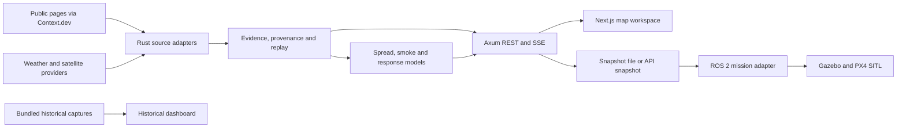

 # BrasaScout

EmberWatch brings wildfire reports, weather and terrain onto one map of mainland
Portugal. It keeps the source behind each report visible, replays how an incident
developed, and explores how simulated drones could respond.

The project has a bilingual web dashboard, a Rust backend for evidence and
modelling, and a ROS 2/Gazebo/PX4 flight simulation. Reports and historical
observations are kept separate from predicted spread and simulated response.
All drone missions, water drops and dispatch decisions are simulations.

## What it does

- **Map and replay:** explore Portugal in 3D and replay the Arganil/Piódão fire
  from 13-14 August 2025 using captured public reports and archived model inputs.
- **Cited evidence:** inspect source links, capture times, publication times,
  extraction checks and shared reporting lineage.
- **Spread and smoke:** run an experimental Rust fire model using terrain,
  fuel and weather, then compare historical predictions with observed perimeters.
- **Response planning:** inspect illustrative drone routes, fleet estimates and
  briefings. The ROS demo flies a simulated PX4 x500 around configured hazards.
- **Synthetic fallback:** run a separate training scenario without source keys.
  Invented incidents are labelled synthetic throughout.

The dashboard's Live view can fall back to a bundled status capture. Read its
checked time before treating it as current. Recurring Fogos.pt ingestion remains
disabled pending source checks; a failed or partial capture never establishes
that there are no fires.

## How it fits together



Historical dashboard assets are prebuilt. The interactive API workspace uses
REST snapshots and server-sent events. ROS consumes the shared Snapshot JSON
contract rather than importing backend internals. See the
[ROS node and topic guide](docs/ROS.md) for the flight simulation graph.

## Run the web demo

Use Node.js 22+ and npm. From the repository root:

```sh
cd web
npm ci
npm run dev
```

Open [127.0.0.1:3000](http://127.0.0.1:3000). The bundled dashboard and replay
need no source API keys or running backend. Map tiles still require internet
access and WebGL.

| Route | View |
|---|---|
| `/` | Portugal dashboard with captured status and Arganil 2025 replay |
| `/data` | Captured evidence and source details |
| `/methods` | Modelling methods and limitations |
| `/terrain` | Terrain and building explorer |
| `/workspace` | Synthetic replay and REST/SSE workspace |

## Run the Rust service

The toolchain is pinned to Rust 1.100.0 in `rust-toolchain.toml`. From the
repository root, start a demo with network acquisition disabled:

```sh
FIRECAST_AUTO=false FIRECAST_NETWORK=false cargo run --locked -p emberwatch-server
```

In a second terminal:

```sh
cd web
NEXT_PUBLIC_API_BASE_URL=http://127.0.0.1:8080/platform/ui npm run dev
```

Open [the workspace](http://127.0.0.1:3000/workspace). It connects to the
platform's synthetic training scenario through the browser adapter. Without
`NEXT_PUBLIC_API_BASE_URL`, this view uses local synthetic fixtures.

The dashboard at `/` has a separate status-loading path; the workspace adapter
does not supply `/api/live/status`. The ROS adapter uses the original
`/api/snapshot?run_id=synthetic-portugal` endpoint.

The service reads process environment variables and does not load `.env`
automatically. Configuration, PostgreSQL, source credentials and Windows commands
are in the [setup guide](docs/SETUP.md).

## Run the ROS demo

ROS 2 Jazzy, Gazebo Harmonic and the PX4 workspace are separate dependencies.
Start with [ros2/README.md](ros2/README.md) for build and launch commands, then
read [docs/ROS.md](docs/ROS.md) for nodes, topics, coordinate frames and mission
flow. [ros2/ARGANIL_DATA.md](ros2/ARGANIL_DATA.md) records the terrain sources,
licences and scene approximations.

## Repository layout

| Path | Responsibility |
|---|---|
| `crates/domain/` | Shared types, validation, source and clock contracts |
| `crates/platform/` | Source scheduling, fusion, replay, uploads and persistence |
| `crates/intelligence/` | Context.dev, public-page extraction, IPMA and webhooks |
| `crates/firecast/` | Fire spread, fuel, weather, smoke and historical evaluation |
| `crates/response/` | Illustrative spread, route planning and PT/EN briefings |
| `crates/server/` | Axum entry point, REST routes, SSE and composition |
| `web/` | Next.js, TypeScript, MapLibre and deck.gl views |
| `ros2/` | Mission adapters, planners and Gazebo/PX4 simulation |
| `contracts/` | OpenAPI, JSON Schemas and synthetic fixtures |
| `data/` | Captured demo evidence and historical model inputs |
| `migrations/`, `infra/` | Database schema and local service setup |
| `scripts/`, `tests/` | Contract validation and integration smoke checks |

## Checks

Run Rust and contract checks from the repository root:

```sh
cargo fmt --all -- --check
cargo clippy --workspace --all-targets -- -D warnings
cargo test --workspace
python3 -m pip install -r requirements-dev.txt
python3 scripts/check_contracts.py
```

Run frontend checks from `web/`:

```sh
npm test
npm run lint
npm run typecheck
npm run build
```

Run ROS Python tests with `python3 -m pytest -c ros2/pytest.ini` from the root.
They cover snapshot adaptation, coordinate conversion, hazard planning and scene
generation without launching a flight. With the Rust service running,
`node tests/smoke.mjs` checks the original synthetic HTTP/SSE flow.
PostgreSQL tests require a disposable database; see the
[setup guide](docs/SETUP.md#validation-with-postgresql).

## Data and model boundaries

Positions use `[longitude, latitude]`. Timestamps are stored in UTC and displayed
in `Europe/Lisbon`. Missing values stay `null`; capture time is not ignition time.
Historical reports are revealed using their recorded availability rules. Later
captures can contain edits, so replay coverage and timing remain qualified.

The fire and smoke models are experimental and uncalibrated for operational use.
ROS fire growth and water effects are illustrative model state, not camera-based
sensing or validated suppression physics. Scene geometry and configured hazards
do not establish complete obstacle or airspace coverage.

Read the [demo data guide](docs/DEMO_DATA.md),
[source research](docs/DATA_SOURCES.md),
[forecast model guide](crates/firecast/README.md), and
[web guide](web/README.md) for provenance, attribution and limitations.
The [build plan](docs/PLAN.md) records the original scope and implementation
checkpoints; it also includes work that remains planned.
