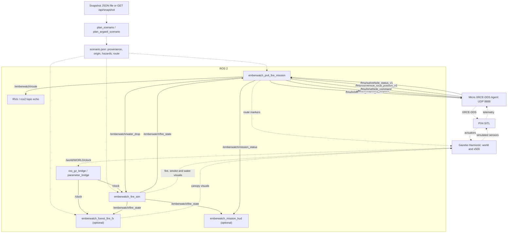
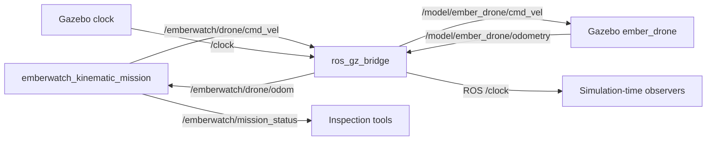
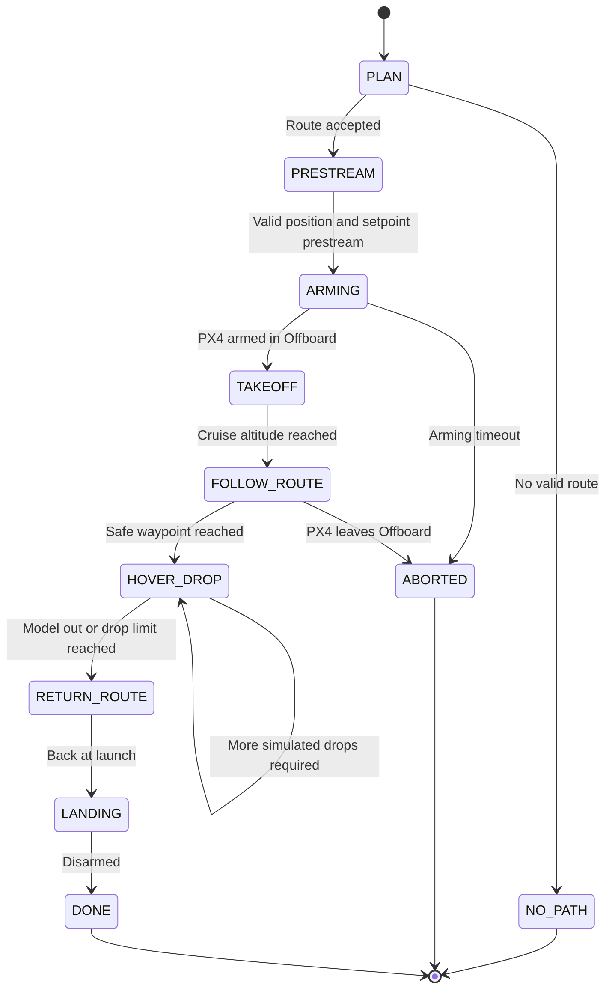

# ROS 2 nodes and topics

The ROS workspace adapts a cited EmberWatch Snapshot into a local flight scenario.
Gazebo simulates the scene, PX4 SITL flies the x500, and ROS nodes coordinate the
mission and illustrative fire state. The Rust service and ROS package share JSON
contracts; they run as separate processes.

Build and launch commands are in [ros2/README.md](../ros2/README.md).
Scene sources and licences are in [ARGANIL_DATA.md](../ros2/ARGANIL_DATA.md).

## PX4 fire demo connections

Solid arrows below carry ROS messages. Dashed arrows carry files, simulator
transport or the PX4 XRCE-DDS connection. Gazebo transport topics are separate
from ROS topics unless an explicit bridge connects them.



`WORLD` is `emberwatch_px4` for the flat scene or `emberwatch_arganil` for the
generated terrain scene. `forest_fire_fx` is an optional canopy visual consumer;
`mission_hud` is an optional GUI status display. Neither controls the aircraft.

## Nodes and tools

| Executable | ROS node name | Responsibility |
|---|---|---|
| `px4_fire_mission` | `emberwatch_px4_fire_mission` | Plan or load a route, stream PX4 setpoints, request simulated water drops, return and land |
| `fire_sim` | `emberwatch_fire_sim` | Advance the illustrative fire model, process water commands and publish state |
| `parameter_bridge` | `ros_gz_bridge` node; name depends on launch | Connect Gazebo clock to ROS; also bridge velocity/odometry in the kinematic demo |
| `forest_fire_fx` | `emberwatch_forest_fire_fx` | Optional canopy visuals driven by matching simulated fire state |
| `mission_hud` | `emberwatch_mission_hud` | Optional recording overlay showing simulation elapsed time and status |
| `px4_offboard_mission` | `emberwatch_px4_offboard_mission` | Standalone minimal takeoff, local target, status-only drop and RTL example |
| `kinematic_mission` | `emberwatch_kinematic_mission` | Standalone Gazebo velocity-controlled demonstration without PX4 |

`plan_mission`, `plan_scenario`, `plan_arganil_scenario` and `gen_arganil_world`
are command-line tools, not persistent ROS nodes. The first adapts a Snapshot;
the scenario tools add local geometry and preflight planning; the world generator
writes scene assets and the obstacle raster. `mission.py`, `geo.py`, `hazard.py`
and `planner.py` are reusable Python modules with no ROS dependency.

The minimal offboard, fire-mission and kinematic controllers are alternative
launch modes. Run one controller for a vehicle at a time.

## ROS topic reference

These are the default application topics. ROS also provides standard discovery,
logging and parameter interfaces, and PX4 exposes telemetry beyond what this
package consumes.

| Topic | Message type | Publisher | Subscriber / use |
|---|---|---|---|
| `/fmu/in/offboard_control_mode` | `px4_msgs/msg/OffboardControlMode` | Active PX4 mission node | PX4 through XRCE-DDS; declares position control |
| `/fmu/in/trajectory_setpoint` | `px4_msgs/msg/TrajectorySetpoint` | Active PX4 mission node | PX4 through XRCE-DDS; local NED position and yaw |
| `/fmu/in/vehicle_command` | `px4_msgs/msg/VehicleCommand` | Active PX4 mission node | PX4 through XRCE-DDS; mode, arm, land or RTL commands |
| `/fmu/out/vehicle_local_position_v1` | `px4_msgs/msg/VehicleLocalPosition` | PX4 through XRCE-DDS | Active PX4 mission node; local position, validity and EKF origin |
| `/fmu/out/vehicle_status_v1` | `px4_msgs/msg/VehicleStatus` | PX4 through XRCE-DDS | Active PX4 mission node; arming and navigation state |
| `/emberwatch/fire_state` | `std_msgs/msg/String` containing JSON | `fire_sim` | Fire mission, optional visual/HUD nodes and inspection tools |
| `/emberwatch/water_drop` | `std_msgs/msg/String` containing JSON | `px4_fire_mission` | `fire_sim`; active flag, ENU position and scenario ID |
| `/emberwatch/mission_status` | `std_msgs/msg/String` containing JSON | Active mission node | HUD and inspection tools; mission phase and outcome |
| `/emberwatch/route` | `nav_msgs/msg/Path` | `px4_fire_mission` | RViz or other observers; frame `emberwatch_enu` |
| `/clock` | `rosgraph_msgs/msg/Clock` | Gazebo clock bridge | Nodes configured with `use_sim_time:=true` |
| `/emberwatch/drone/cmd_vel` | `geometry_msgs/msg/Twist` | `kinematic_mission` | ROS-to-Gazebo bridge; kinematic demo only |
| `/emberwatch/drone/odom` | `nav_msgs/msg/Odometry` | Gazebo-to-ROS bridge | `kinematic_mission`; kinematic demo only |

Telemetry topic names can be overridden with `topic_local_position` and
`topic_vehicle_status` on the PX4 mission nodes. Inspect the actual endpoints
when using another PX4/message version.

The fleet controller under development uses the same PX4 message types under
per-vehicle namespaces, `/px4_<k>/fmu/in/...` and `/px4_<k>/fmu/out/...`, and shares
the scenario-scoped fire, water and mission-status topics. It is separate from
the single-vehicle launch flow above; its presence does not establish a tested
multi-vehicle demo.

### Delivery and timing

- PX4 telemetry subscribers use best-effort reliability, transient-local
  durability and depth 1 to match the bridge's telemetry QoS.
- Fire state, mission status and route publishers use reliable, transient-local
  delivery at depth 1 so compatible late subscribers can receive the latest value.
- Water commands and PX4 command/setpoint publishers use depth 10 with the
  default reliable, volatile policy.
- PX4 setpoints and Offboard control mode are streamed at 10 Hz. The fire model
  steps at 10 Hz and publishes state at 2 Hz.
- The launch script sets `use_sim_time:=true` for fire/visual nodes. Fire growth
  follows Gazebo time. The mission uses PX4 feedback timestamps for simulated
  flight timing and monotonic wall time for startup/freshness checks.

### Application payloads

`/emberwatch/fire_state` includes `scenario_id`, `incident_id`, `active`,
`intensity`, `radius_m`, `elapsed_s`, `water_applied_s`, `water_active`,
`water_in_effective_range`, wind metadata and spread-point counts. Its label
explicitly identifies simulated state access.

For a single-vehicle water command:

```json
{
  "scenario_id": "<the current scenario ID>",
  "active": true,
  "pos_enu": [12.0, -8.0, 16.0]
}
```

The mission and fire nodes ignore fire/water messages with a different
`scenario_id`. This prevents stale messages from a previous scenario affecting
the current run. It does not replace namespace isolation for concurrent flights.
Mission status carries the phase, explanatory note, positions, source links and
accumulated results; it is a presentation stream rather than a command channel.

## Kinematic demo connections

The lightweight demo uses
[bridge.yaml](../ros2/src/emberwatch_drone/config/bridge.yaml) and
[kinematic_demo.launch.py](../ros2/src/emberwatch_drone/launch/kinematic_demo.launch.py).
It has no PX4 or XRCE-DDS agent.



The kinematic node commands velocity at 20 Hz. Its water emitter is toggled
directly through Gazebo transport at
`/model/ember_drone/link/base_link/particle_emitter/sim_water/cmd` using
`gz.msgs.ParticleEmitter`. That endpoint is not a ROS topic. Its drop is visual
only and does not use the fire-model suppression loop.

## Coordinate frames

| Boundary | Convention |
|---|---|
| Snapshot / GeoJSON | `[longitude, latitude]` in WGS84 degrees |
| Scenario / Gazebo / published route | ENU metres: x east, y north, z up |
| PX4 local position / setpoint | NED metres: x north, y east, z down, relative to the EKF origin |
| Wind | Meteorological direction in degrees clockwise from north, indicating where wind comes from |

Ignoring origin offsets, ENU-to-NED conversion is `(north, east, down) =
(y, x, -z)`. The mission also accounts for the offset between scenario origin
and PX4's reported EKF origin, including altitude. NED yaw is `pi/2 - yaw_enu`,
wrapped to `[-pi, pi]`. See [geo.py](../ros2/src/emberwatch_drone/emberwatch_drone/geo.py).

In the flat scene, the scenario origin is the simulated launch site. In Arganil,
the map origin is fixed and the launch point is a separate location in that map.
Mixing world z, height above local ground and PX4 local z produces incorrect
clearance, so the obstacle raster and route geometry use the same world frame.

## Mission lifecycle



The controller refuses takeoff without a valid route. On arrival it hovers at
the configured safe point, requests water, then checks fresh fire state from the
same scenario. Stale state is reported as unknown rather than proof of an effect.
The ordinary return follows the planned route. If PX4 leaves Offboard, the
controller aborts and does not request Offboard again; PX4's own failsafe return
is not aware of the application's configured hazards.

## Inspect the running system

After sourcing ROS, the PX4 message workspace and this workspace:

```sh
ros2 node list
ros2 node info /emberwatch_px4_fire_mission
ros2 topic list -t
ros2 topic info /fmu/out/vehicle_local_position_v1 --verbose
ros2 topic echo /emberwatch/fire_state --qos-durability transient_local
ros2 topic echo /emberwatch/mission_status --qos-durability transient_local
ros2 topic echo /emberwatch/route --qos-durability transient_local
ros2 topic hz /clock
```

For Gazebo transport, use `gz topic -l` in the demo's `GZ_PARTITION`. The run
script defaults to `emberwatch_px4` and binds transport to `GZ_IP=127.0.0.1`.
Gazebo and ROS have separate discovery mechanisms.

| Symptom | Check |
|---|---|
| No `/fmu/out/...` topics | Agent on UDP 8888, PX4 startup, matching `px4_msgs` and sourced workspace |
| Topics exist but no position arrives | Versioned names, subscriber QoS and PX4 position-validity flags |
| Fire time does not advance | `/clock` bridge and `use_sim_time` on `fire_sim` |
| Fire/water message ignored | `scenario_id` matches the loaded `scenario.json` |
| `NO_PATH` before takeoff | Scenario hazards, unknown-wind buffer, obstacle raster and planner result |
| World fails to load | Generated SDF/assets, `GZ_SIM_RESOURCE_PATH` and Gazebo process log |
| Outcome is unclear | `summary.json`, `mission.log`, `fire_sim.log`, `px4.log` and `clock_bridge.log` under `ros2/run_logs/` |

The Python tests check model and planner invariants without a simulator. They do
not establish flight performance, camera sensing or real firefighting capability.
